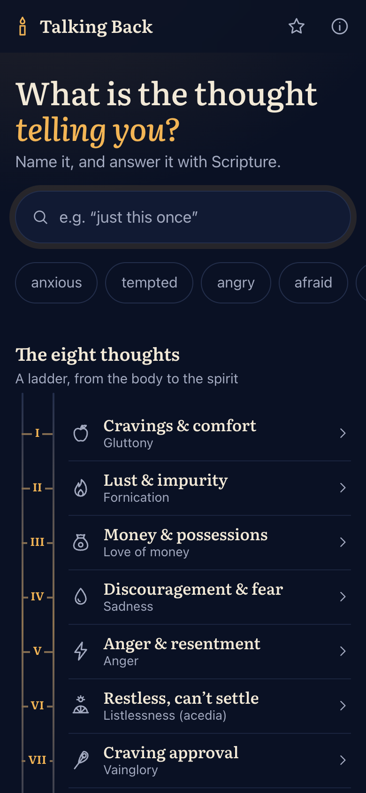
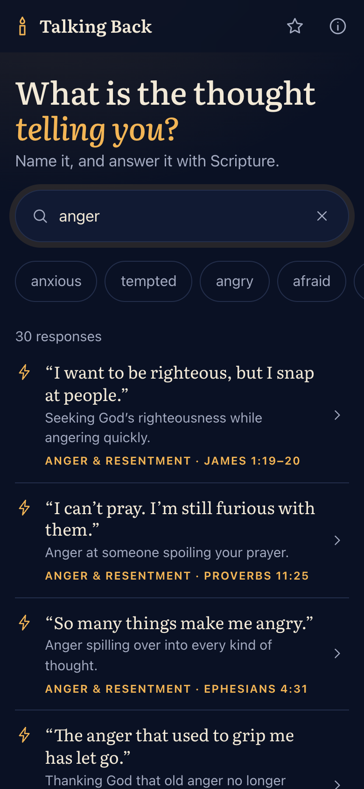
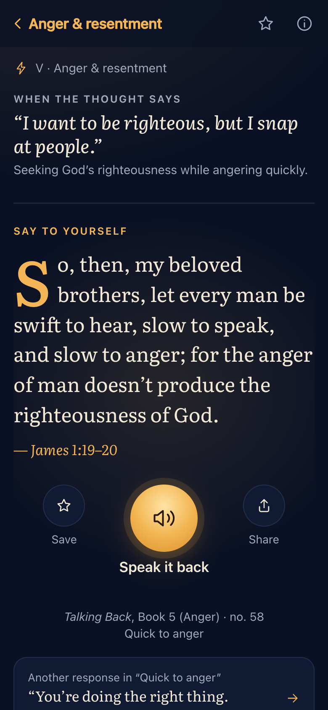

# Talking Back

A phone-first web app inspired by Evagrius of Pontus’s *Talking Back*: recognize the thought, and get a Bible verse to answer it within seconds. It works offline and can be installed to the home screen.

**Try it:** [talking-back.vercel.app](https://talking-back.vercel.app) (testing build)

<p align="center">
  
  
  
</p>

```bash
npm install
npm run dev        # http://localhost:5173
npm run build      # rebuilds data/entries.json, type-checks, writes dist/
```

## iOS and Android apps

`ios/` and `android/` are [Capacitor](https://capacitorjs.com) projects that bundle the same build, so the apps work offline. Native touches (share sheet, text-to-speech, haptics, status bar, splash) live in `src/lib/native.ts` and `src/lib/speak.ts`; on the web they fall back to the browser's own.

```bash
npm run sync           # build, then copy dist/ into both native projects
npm run ios            # sync and open Xcode (needs Xcode 26+)
npm run android        # sync and open Android Studio
npm run native-assets  # redraw app icons and splash screens from public/icon.svg
```

Setup, testing and store submission: [docs/store-release.md](docs/store-release.md).

## Data

`data/entries.json` is the single file the app reads, and the contract a future iOS app will reuse. It is generated; don’t edit it by hand.

| File | What it holds |
| --- | --- |
| `data/skeleton.json` | Every entry in the book: book, number, kind (rebuke / self / prayer), Septuagint reference. Facts only. |
| `data/refs.json` | Each reference converted to standard English numbering (World English Bible). |
| `data/thoughts.json` | The eight thoughts, their modern names and their clusters. |
| `data/authoring/NN-<thought>.json` | Hand-written per entry: `voice`, `situation`, `tags`, `cluster`, optional `note`, `lead: "greek"`, `excerpt`, and reference fixes (`web`, `greekRef`). |

Rebuilding from scratch:

```bash
npm run fetch-bibles                                  # WEB + Brenton into .cache/bibles
pdftotext -bbox -f 62 -l 184 <book.pdf> <work>/bbox.html
node scripts/parse-entries.mjs <work>/bbox.html <work>/reading.txt
node scripts/map-refs.mjs <work>/reading.txt <work>/review.txt
node scripts/build-data.mjs --reading <work>/reading.txt
```

`reading.txt` and `review.txt` contain the copyrighted translation and must stay outside this folder. They are used only to match verse references, and by the build’s copyright check, which fails if any modern wording shares an 8-word run with the translation.

## Deploying the web app (Vercel)

`vercel.json` makes Vercel run `npm run build:web`, which skips the data step: `data/entries.json` is committed, and the Bible texts it is built from live only in the local `.cache`.

- **Testing phase:** every page is sent with `X-Robots-Tag: noindex, nofollow`, so search engines leave the site alone. Delete that header rule from `vercel.json` when the app launches publicly.
- **Feedback link:** set `VITE_FEEDBACK_URL` (an https form link) in the Vercel project's Environment Variables, then redeploy. The About page then shows a Feedback section. Builds without it, such as the store apps, leave it out.
- **Updates:** `sw.js` is never cached by the CDN, so testers pick up each new deploy when they reopen the app.
- **Plan:** Vercel’s free Hobby plan covers personal, non-commercial projects (donation links are fine). Paid apps, in-app purchases or ads need Vercel Pro or another host.

## Sources

- Verses: *World English Bible* (US, “LORD” edition), public domain.
- Greek Old Testament wording: Brenton’s English Septuagint (1851), public domain.
- Typeface: Literata (Latin subset, `src/assets/fonts/`), SIL Open Font License.
- Painting (About screen): Juan de Flandes, *The Temptation of Christ*, c. 1500–1504, National Gallery of Art, Washington, accession 1967.7.1. Public domain, from the NGA’s open-access images (free for any use). `src/assets/art/` holds a 600 px copy.
- Crisis lines in `src/lib/care.ts` were checked in October 2026; recheck them before each store release.
- Entry numbering follows David Brakke’s translation, *Talking Back* (Liturgical Press, 2009). The app’s situations are original modern wording, not quotations.

## License

Copyright © 2026 Enea-13. All rights reserved. The source is public to read and learn from, but please ask before reusing the code or the written entries in `data/authoring/`. The verses, painting and typeface listed under Sources keep their own public-domain or open licenses. Full terms: [LICENSE](LICENSE).
